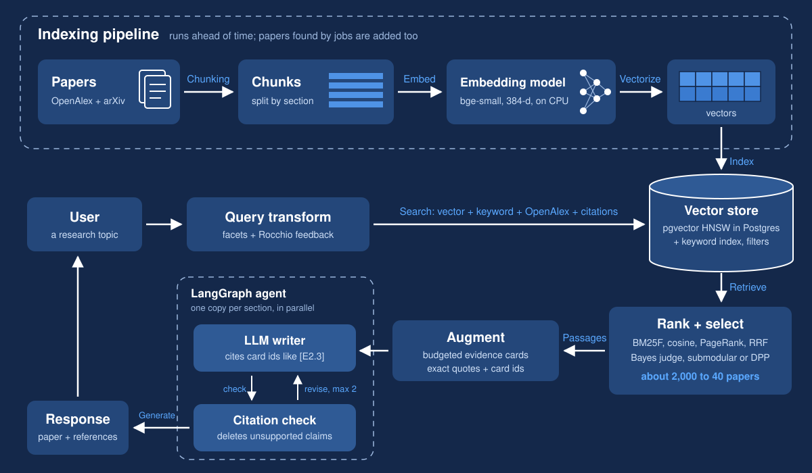
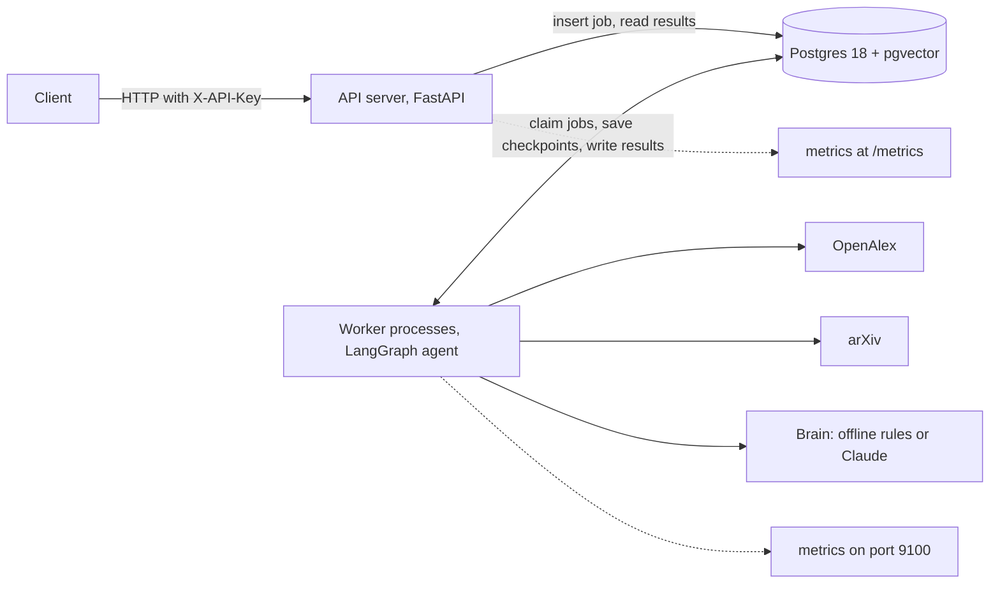
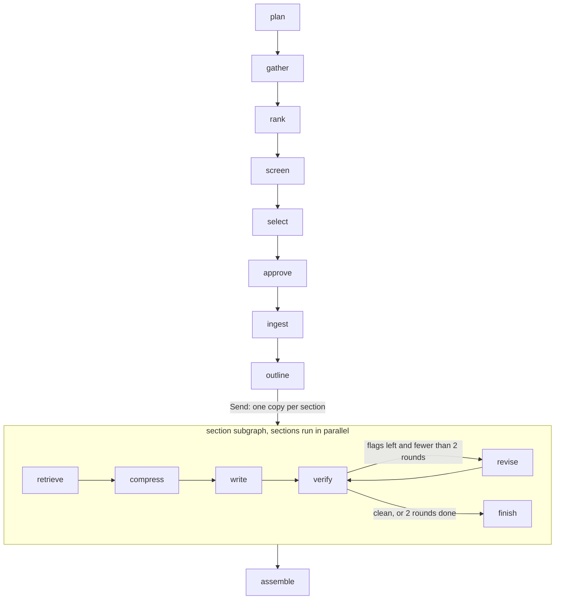
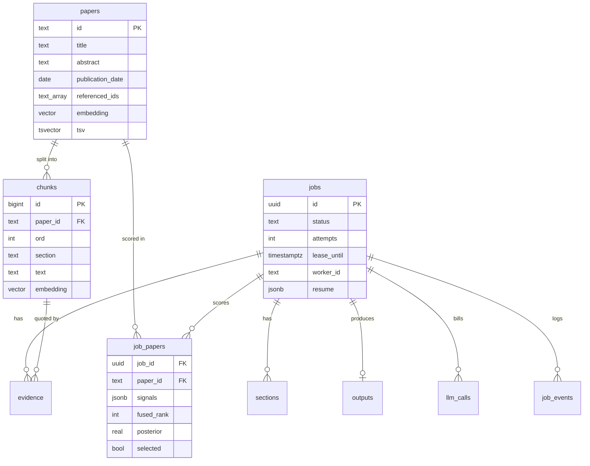

# Architecture

## 1. What it does

You give the system a research topic. It finds a few thousand candidate papers, picks about 40 that best cover the topic, reads them, and writes a short review paper. Every claim in that paper is backed by a quote that the code checked word for word against the source.

The core idea is a **funnel**: cheap methods look at many papers, expensive methods look at few. Keyword and vector search can score thousands of papers in a fraction of a second. An LLM judge, full-text reading, and writing are slow and cost money, so they only see the papers that survived the cheap steps. In a real run (see `samples/`), 373 candidates were narrowed to 150, then to 40, and the writing steps only ever touched those 40.

## 2. How data flows

The top half is the **indexing pipeline**: it gets papers into the store. The bottom half is the **query side**: it answers one topic.

- **Papers** come from OpenAlex (a free catalog of about 250 million papers with titles, abstracts, and citation links) and arXiv (free full text). `sources/openalex.py` rebuilds each abstract from OpenAlex's word-position format. `sources/arxiv.py` downloads PDFs at most once every 3 seconds, the rate arXiv asks for.
- **Chunks** are pieces of a paper's text, about 500 tokens each. `text/chunking.py` splits at section headings (Introduction, Method, Results) so a chunk is about one thing, packs whole sentences so a quote is never cut in half, and overlaps neighbors a little so a claim near a boundary appears whole somewhere.
- **The embedding model** (`embed.py`) turns text into 384 numbers, a vector, such that texts with similar meaning get vectors that point in similar directions. It is `BAAI/bge-small-en-v1.5`, small enough to run on a CPU.
- **The vector store** is Postgres with the pgvector extension (`db/schema.sql`, `db/papers.py`). It holds paper and chunk vectors under an HNSW index (a graph that finds nearby vectors without comparing against all of them) and a keyword index. Papers found by any job stay in the store, so the corpus grows with use.
- **Query transform**: the brain splits the topic into 4 to 8 facets (sub-questions), each with keyword phrases. Rocchio feedback later nudges each facet's vector toward its best early results.
- **Search and retrieve** (`funnel.gather`): look in the local store first, then OpenAlex keyword search per facet, then follow citation links out of and into the strongest early papers ("snowballing").
- **Rank + select** (`funnel.py`, `ranking/`): score every candidate with BM25F (keywords), cosine similarity (vectors), and Personalized PageRank (citations), merge the rankings with Reciprocal Rank Fusion, ask the judge about the top 150, turn verdicts into probabilities with Bayes' rule, and pick the final set with submodular greedy or a DPP. `docs/math.md` explains each step.
- **Augment** (`writing.py`): for each section, retrieve the best passages from the chosen papers, pack them into a token budget, and turn them into **evidence cards**: a claim plus a quote copied from the chunk. Code throws out any card whose quote is not found in its chunk.
- **The LangGraph agent** writes each section from its cards only, citing card ids like `[E2.3]`, then checks every citation and revises or deletes what the quotes do not support.
- **Response**: the paper in Markdown, a BibTeX reference list built from metadata (never written by the LLM), and a report that explains every pick.

## 3. Where it runs

The API never runs the agent. It writes a row and answers right away with `202 Accepted` and a job id, because writing a paper takes minutes and an HTTP request should not hang that long. Workers are separate processes that do the slow work. To handle more jobs, run more workers: `docker compose up -d --scale worker=3`.

## 4. The agent graph

- Each box is a **node**: a function in `agent/nodes.py` that loads what it needs from Postgres, calls pure logic in `funnel.py` or `writing.py`, and saves the result. Keeping the logic out of the nodes means tests and evals run the exact same code without a database.
- **Fan-out with `Send`**: after `outline` decides the sections, the graph starts one copy of the section subgraph per section, all at once. Only the list of finished section numbers flows back (`SectionOut`), so parallel sections never overwrite each other's state.
- **Human approval**: `approve` calls LangGraph's `interrupt()`. The job pauses with status `waiting_approval`; `POST /v1/jobs/{id}/approve` can remove or add papers, and a worker resumes the graph with `Command(resume=...)`. It sits after selection and before full-text reading, so a person checks the cheap part before the expensive part. Jobs skip it unless `auto_approve` is false.
- **Small state**: LangGraph saves a checkpoint after every node. The state holds ids and small values only; papers, chunks, cards and drafts live in tables. Small state keeps every checkpoint fast and cheap.

## 5. Data model

- `papers.embedding` and `chunks.embedding` have HNSW indexes (`m = 16, ef_construction = 64`); `tsv` columns have GIN indexes for keyword search.
- Searching vectors with a filter (only papers before a date) can starve an HNSW index, because the index finds the nearest vectors first and the filter then throws most away. pgvector's iterative scans (`SET hnsw.iterative_scan = relaxed_order`) keep the index searching until enough rows pass the filter.
- Postgres's own keyword ranking (`ts_rank_cd`) is not BM25: it has no proper inverse document frequency or saturation. It is used only to fetch candidates from the stored corpus; exact BM25F scoring happens in NumPy over the job's pool.
- `job_papers` keeps every score for every candidate, so any pick can be explained after the fact.

## 6. Reliability

- **Exactly one worker per job.** A worker claims the oldest queued job with `SELECT ... FOR UPDATE SKIP LOCKED`: Postgres locks the row it hands out, and other workers skip locked rows instead of waiting. `test_two_workers_never_claim_the_same_job` checks it.
- **Leases and heartbeats.** A claim includes a lease, a claim that expires in 2 minutes unless renewed. The worker renews it every 30 seconds. If a worker dies, its lease runs out, and any worker's reaper puts the job back in the queue. After 3 attempts the job is marked failed.
- **Resume, not restart.** LangGraph checkpoints after every node, so the next worker continues from the last finished step. `test_crash_mid_job_resumes_from_checkpoint_on_another_worker` kills a worker in the middle of `outline` and checks that `gather` and `ingest` did not run again.
- **Idempotent steps.** Every node is safe to run twice: writes are inserts-or-updates keyed by job and item, and chunk replacement happens in one transaction.
- **Retries with backoff.** Calls to outside services retry on 429 and 5xx with exponential backoff and full jitter (a random wait between 0 and min(30 s, 2^attempt s)), honor `Retry-After`, and give up after 5 tries. The randomness stops many clients from retrying at the same moment.
- **Rate limits.** OpenAlex gets at most 8 requests per second (its limit is 10). arXiv gets one request every 3 seconds on one connection.
- **Small failures stay small.** A paper whose PDF fails falls back to its abstract (in the sample run, 17 papers had PDFs and 23 used abstracts). A section that cannot keep 2 supported sentences is dropped and listed in the report; the job still finishes.
- **Deadline, budget, cancel.** A job fails after 30 minutes, or once its LLM spend passes its budget (default $10). A cancel takes effect at the next step boundary. On shutdown (SIGTERM) a worker finishes its current step, hands the job back, and exits.

## 7. Observability

- **Logs**: one JSON object per line, tagged with `job_id` and `node` through a contextvar, so every line from one job can be filtered together.
- **Metrics** (Prometheus): `jobs_total{status}`, `node_duration_seconds{node}`, `llm_tokens_total{model,kind}`, `llm_cost_usd_total{model}`, `external_requests_total{service,outcome}`, `queue_depth`.
- **Trace**: `GET /v1/jobs/{id}/trace` lists each step with its time, LLM cost, and counts. From the sample run (`samples/trace.json`):

| Step | Seconds | Counts |
|---|---|---|
| gather | 15.0 | 373 candidates found (OpenAlex answers from the HTTP cache; about 38 s live) |
| rank | 0.10 | 373 in, 150 out |
| screen | 0.03 | 150 judged, 90 included |
| select | 0.02 | 40 selected |
| ingest | 54.7 | 17 PDFs, 23 abstract only |
| outline | 0.02 | 3 sections (eigengap) |
| assemble | 0.01 | 12 references |

Almost all the time goes to talking to OpenAlex and arXiv. The math takes milliseconds.

## 8. Security

- Every route except health checks needs the `X-API-Key` header, compared in constant time (so response timing reveals nothing about the key). The API logs a warning when the key is still the default.
- Every input is validated (topic length, paper counts, year range, id formats); bad input gets a 422 with one error shape.
- Prompt injection: a paper's abstract could contain text like "ignore your instructions." Paper text is escaped and wrapped in tags, and the system prompt says tagged text is data. Outputs are structured, quotes must match their source, and references come only from metadata, so injected text cannot add references or unsupported claims.
- Secrets come only from environment variables or `.env` (which git ignores) and are never logged.
- Containers run as a non-root user. PDFs are read in memory and never stored or served.

## 9. Decisions and trade-offs

| Decision | Why | What we gave up | When to revisit |
|---|---|---|---|
| Postgres as the job queue | One fewer service to run; `SKIP LOCKED` gives exactly-once claims | Very high job rates; push-based delivery | Thousands of jobs per second, or many consumers per event: move to SQS or Kafka |
| pgvector for vectors | Vectors, keywords, filters and joins in one database and one transaction | The best ANN performance at billions of vectors | Hundreds of millions of vectors per index: sharded ANN service |
| Hand-written BM25F over the pool | Exact BM25 with field weights; IDF computed over the topic's own pool | Speed at corpus scale | Corpus-wide keyword search: OpenSearch or ParadeDB |
| Offline brain as the default | Free, repeatable, testable, and a baseline the LLM must beat | Writing quality: extractive, delete-only revisions | When an API key is available (set `BRAIN=claude`) |
| Sections written in parallel | Lower wall-clock time; independent failures | Cross-section coherence | If reviews need tight narrative flow: a final smoothing pass |
| arXiv-only full text, read with pypdf | Clear terms; simple, dependency-light parsing | Coverage beyond arXiv; table and figure structure | GROBID for structure; publisher open-access PDFs with license checks |
| One strong model, effort set per step | Simple; lower effort is cheap on routine steps | Possible savings from cheaper models | When evals show a cheaper model holds quality on a step |
| Small checkpoint state (ids only) | Fast checkpoints after every node | One extra database read per node | Never, at this scale |

## 10. Growing to 200 million papers

This project indexes papers as jobs find them. At SciSpace's scale, the pieces change like this:

- **Offline indexing**: embed the whole corpus ahead of time in batch jobs (Spark or Ray on GPUs), and re-embed only new or changed papers each day.
- **Sharded vector indexes**: split vectors across many machines, compress them (IVF-PQ, DiskANN, or `halfvec` half-size floats; the vector lab shows 32 times smaller vectors), and re-rank the top results with full vectors.
- **Keyword search** in a search engine built for it (OpenSearch), with BM25 and filters.
- **A precomputed citation graph** with global PageRank; per-topic Personalized PageRank then starts from a warm solution.
- **Cache screening verdicts** per (paper, criteria) pair, because popular topics repeat.
- **Self-hosted models** for embeddings and screening (for example vLLM in Docker on Kubernetes) to cut per-call cost; the strongest hosted model only for writing.
- **Autoscaled workers** driven by `queue_depth`, and a dedicated queue once Postgres becomes the bottleneck.
- **The Batch API** (half price, slower) for screening that does not need an answer within minutes.
- **Evals on every change**: the survey-based eval in `evals/` runs before any model, prompt, or weight change ships.
