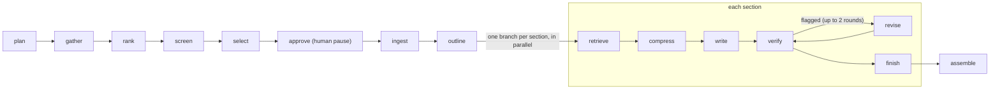

# Interview prep

This is the one-stop prep document for the SciSpace interview. It explains the project, gives you what to say, and ends with a practice drill. For the full math and proofs, see [math.md](math.md). For the system in depth, see [architecture.md](architecture.md).

> **The question from the interview round:** Given thousands of relevant papers for a topic, how would you evaluate and select the most pertinent ones, and what would the agentic architecture look like to synthesize them into a well-cited research paper?

This repository is a working answer to that question:
- It picks papers with ranking math you can explain line by line.
- It writes a review where every claim points to a quote that was checked word for word.
- It runs as a crash-safe service.

**The funnel in the sample run** (`samples/`):

| Papers | Stage | How |
|---:|---|---|
| 373 | candidates | keyword search per sub-question, plus citation snowballing |
| 150 | shortlisted | BM25F, vectors and PageRank, merged with rank fusion |
| 40 | selected | an LLM judge weighed with Bayes' rule, then a set objective |
| 12 | cited | each one through a verified quote |

In production the pool would be a few thousand papers; the shape stays the same.

## Contents

1. [The 60-second answer](#1-the-60-second-answer)
2. [How it fits together](#2-how-it-fits-together)
3. [Selecting papers: the math](#3-selecting-papers-the-math)
4. [Writing with proof](#4-writing-with-proof)
5. [The production shell](#5-the-production-shell)
6. [What the evals say](#6-what-the-evals-say)
7. [One job, traced](#7-one-job-traced)
8. [Stories to tell](#8-stories-to-tell)
9. [Weak spots to own](#9-weak-spots-to-own)
10. [Five-day plan](#10-five-day-plan)
11. [Practice drill](#11-practice-drill)

## 1. The 60-second answer

Say these six points in order, one or two sentences each. Then stop and let the interviewer pick the thread they care about.

1. **A funnel.** Cheap methods look at thousands of papers; expensive ones look at few. Keyword search, vectors and the citation graph score every candidate in milliseconds. An LLM judge sees only the top 150, and full-text reading and writing see only the final 40.
2. **Three kinds of evidence, merged by rank.**
   - BM25F catches exact terms, embeddings catch meaning, and Personalized PageRank catches what the topic builds on.
   - Reciprocal Rank Fusion merges them without having to calibrate their scales.
   - Adding the citation graph raised nDCG@100 by 0.051 (p = 0.032).
3. **Selection is a set problem.** The 40 should be relevant, cover every sub-topic, and not repeat each other. A submodular objective does this with a proven 63% guarantee; a DPP is the bonus alternative.
4. **Evidence cards, not free text.** For each section, retrieve the best passages, pack them into a token budget, and extract claims with exact quotes. Code rejects any quote that is not in the source word for word.
5. **Verify, then revise.**
   - The writer cites card ids.
   - A checker labels each sentence supported, partial or unsupported, and unsupported ones are rewritten or deleted.
   - References are built from metadata, so the model can never invent one.
6. **A production shell.** An async API, a Postgres job queue with leases, LangGraph checkpoints so a crashed job resumes on another worker, retries, rate limits, budgets, metrics, and an eval that uses published surveys as answer keys.

**Why this order works:** it moves from the cheapest idea to the most expensive, the same way the system does. If you blank, think "find, rank, choose, quote, check, run".

## 2. How it fits together

Two processes share one Postgres database. The API takes requests and answers fast; the worker does the slow work in the background.

```
Client            POST /v1/jobs with a topic; gets a job id back right away
  ↓
API (FastAPI)     checks the API key, saves the job as "queued", serves status, trace and the paper
  ↓
Postgres queue    workers claim jobs with FOR UPDATE SKIP LOCKED, so two workers never take the same job
  ↓
Worker            holds a lease, sends a heartbeat every 30 s, runs the LangGraph graph
  ↓
LangGraph graph   runs the steps below and saves a checkpoint after each one
  ↓
Postgres          papers with 384-number embeddings (pgvector), chunks, evidence cards, sections, the final paper
```

The agent graph:



- **`Send`:** LangGraph's fan-out. One message per section starts that section's branch.
- **`interrupt()`:** pauses the graph at `approve`, so a person can add or remove papers before the expensive steps.
- **Checkpointer:** `AsyncPostgresSaver`, keyed by the job id, so another worker can resume the same job.

**Why a fixed graph and not a free-roaming agent:** the work is a known sequence with one loop and one fan-out. A fixed graph is easier to test, bound in cost, and recover after a crash.

**On a whiteboard:** draw five boxes: API, queue, worker, graph, database.

## 3. Selecting papers: the math

"Core" means know it cold; "bonus" means know it if asked. Each method gets the idea in a sentence, the formula, why it works, and our measured number.

### BM25F keyword scoring (core)

Count the query's words in a paper, with three corrections:
- Rare words count more.
- The tenth repeat adds far less than the first.
- Long abstracts don't win just by being long.

The F version weights fields, so a title hit beats an abstract hit.

```
tf~(t,d) = Σ_f  w_f · tf(t,f) / (1 − b_f + b_f · len_f / avglen_f)
score(d) = Σ_t  IDF(t) · tf~ · (k1 + 1) / (tf~ + k1)
IDF(t)   = ln( (N − n_t + 0.5) / (n_t + 0.5) + 1 )

k1 = 1.2   title: w = 2, b = 0.3   abstract: w = 1, b = 0.75
```

- **Saturation.** `x(k1+1)/(x+k1)` climbs toward `k1+1` but never reaches it, so each repeat adds less.
- **The +1 in the log.** It keeps a common word's weight from going negative.
- **Fields first.** Fields are combined before saturation, so a word in both the title and the abstract doesn't collect two full rewards.

### Embeddings, cosine and Rocchio (core)

An embedding turns text into an arrow in 384 dimensions; similar texts point the same way. Rocchio feedback nudges the query's arrow toward its best early results, like adjusting your aim after the first few darts.

```
cos(a, b) = a · b / (|a| |b|)      unit vectors: just a · b, so one matrix multiply scores everything
q'        = α · q + β · mean(top 20 results), then scaled to length 1      α = 1, β = 0.75
```

**Our number:** vectors alone found 2.5 times more survey-cited papers than keywords alone (recall@150 0.203 vs 0.080). Rocchio added only +0.004 nDCG (p = 0.45), so we can't claim it helps.

### Personalized PageRank (core)

Picture a reader who starts at one of the strongest papers for the topic and keeps following references. Each step, with a 15% chance, they jump back to a strong paper. The papers they keep landing on are what the topic builds on, even when those papers use different words.

```
π = (1 − α) · v + α · Pᵀ π        α = 0.85
v = top 50 papers by text score (sums to 1); dangling papers send their mass back to v
```

- **Why it converges.** One step shrinks any error by a factor of α (a contraction), so there is exactly one answer. About 140 steps reach an error of 1e-10.
- **Why "personalized".** Global citation counts reward famous papers from any field. Restarting at topic seeds makes importance topic-specific.

**Our number:** the largest proven gain. Recall@150 rose from 0.186 to 0.242, and nDCG@100 by +0.051 (p = 0.032).

### Reciprocal Rank Fusion (core)

Several judges rank the papers, each on a different scale. Instead of comparing raw scores, each judge gives a paper `1 / (60 + place)` points. A paper ranked well by several judges beats one ranked first by only one.

```
RRF(d) = Σ_i  w_i / (60 + rank_i(d))       absent from a list: adds 0
lists: BM25F and dense per facet (weight 1/F each), PageRank (weight 1)
```

**The honest limit:** equal weights let a weak list drag down a strong one. Dense alone (nDCG 0.165) beat the BM25F + dense fusion (0.129). The fix is learned weights, trained on the survey labels.

### The LLM judge, weighed with Bayes' rule (core)

Treat the judge like a medical test with known error rates. A "yes" from a test that rarely gives false alarms is strong evidence. A "yes" from a test that says yes to everything is weak.

```
Se = P(says include | relevant)      Sp = P(says exclude | not relevant)
LR+ = Se / (1 − Sp)      LR− = (1 − Se) / Sp
posterior odds = prior odds × LR      prior = calibration table by shortlist rank
```

**Our number:** the offline judge has Se 0.69 and Sp 0.46. That makes LR+ about 1.28 and Cohen's kappa 0.06, barely above chance, so the math correctly gives it little weight. If Se = 1 − Sp, then LR = 1 and the prior doesn't move at all.

### Submodular selection and lazy greedy (core)

Picking 40 papers is like picking a sports team: a second goalkeeper adds less than the first. That "diminishing returns" property is called submodularity, and it gives greedy selection a guarantee.

```
F(S) = Σ_f w_f · log(1 + Σ_{d∈S} p_d · r_{d,f})      facet balance: piling onto one facet stops paying
     + (μ/n) · Σ_i p_i · max_{j∈S} s_ij               facility location: every candidate wants a close representative

greedy ≥ (1 − 1/e) · OPT ≈ 63%
```

- **The proof in one line.** The gap to the best set shrinks by a factor of (1 − 1/k) each step. After k steps it is at most (1 − 1/k)^k ≤ 1/e of the optimum.
- **Lazy greedy.** Gains only shrink, so an old gain is an upper bound. Pop the top of the heap and refresh it. If it still wins, it is the true best. Same picks, far less work.
- **Budgeted version.** To fit passages into 6,000 tokens, take the better of gain-per-token greedy and the best single passage. That guarantees ½(1 − 1/e).

### Determinantal point process, DPP (bonus)

Score a whole set by the volume its vectors span, like picking album photos: you want good shots that aren't the same shot twice. Near-duplicates span almost no volume.

```
P(S) ∝ det(L_S)      L = diag(q) · K · diag(q),  K = cosine Gram matrix,  q = exp(2p)
det(L_S) = Π q_i² · det(E_S E_Sᵀ)   (quality × squared volume)
greedy MAP by incremental Cholesky: O(N k²)
```

**Our number:** DPP picked the most varied sets (mean pairwise cosine 0.779 vs 0.825 for top-k). The recall differences were not significant. log det is not monotone, so the 63% bound does not carry over.

## 4. Writing with proof

The writing side is built so the model can't quietly make things up. It only sees evidence it can cite, and code checks every link from claim to quote to paper.

### Outline by spectral clustering (bonus)

Link the 40 papers by similarity: 70% text, 30% shared references. Tight groups become sections, like friend groups at a school. The biggest jump between small eigenvalues tells you how many groups there are.

```
W = 0.7 · cos + 0.3 · coupling   (8 nearest links each)
L_sym = I − D^(−½) W D^(−½)          k = biggest eigengap for k in [3, 8]
sample run: 0.000, 0.282, 0.562, 0.671 ...  jump after the 3rd = 0.109  →  3 sections
```

### Evidence cards (core)

Each section works like this:
- It retrieves its top 40 passages and picks a subset under a 6,000-token budget.
- It turns them into cards: one claim plus the exact quote, with an id like `E2.3`.
- Code drops any card whose quote isn't in its chunk word for word, any repeat, and any quote with glued PDF words.

**Chunking:** split at section headings, then pack whole sentences into chunks of about 500 tokens with 50 tokens of overlap. Everything from "References" or "Appendix" onward is cut.

### Verify and revise (core)

- **Code checks.** Every cited id exists, every paragraph cites something, and long uncited sentences are flagged.
- **Support check.** Each cited sentence is labeled supported, partial or unsupported, judged against its quotes only. A sentence the checker skips counts as unsupported.
- **Repair.** Up to 2 revision rounds, then anything still failing is deleted.
- **References.** Built from OpenAlex metadata in order of first citation. The model never writes one.

**Sample run:** 22 cards, 22 quotes verified, 0 unresolved markers, 0 citation numbers past the end of the reference list, and every sentence cited.

## 5. The production shell

| Piece | What it does | Why |
|---|---|---|
| `SKIP LOCKED` queue | Workers claim jobs from a Postgres table. | No second system to run; transactions cover queue and results together. |
| Lease + heartbeat | A claim expires after 120 s unless renewed every 30 s. | A dead worker's job is noticed and handed on. |
| Reaper | Requeues expired jobs; fails them after 3 attempts. | A job that keeps killing workers can't loop forever. |
| Checkpoints | Saved after every graph step, keyed by job id. | A resumed job skips finished steps. |
| Idempotent writes | Every write is insert-or-update by job and item. | Running a step twice has the same effect as once. |
| Retries | 429, 5xx and connection errors, with backoff and full jitter, 5 tries. | Random waits stop clients from retrying in lockstep. |
| Rate limits + cache | OpenAlex 8 per second, arXiv one request per 3 s, disk cache. | Respects each service's rules; repeat calls are free. |
| Budget | Each LLM call's cost is logged; a job stops past its budget ($10 default). | Cost can't run away. |
| Observability | JSON logs tagged by job and step, Prometheus metrics, a per-job trace. | You can see where time and money go. |
| Docker | API, worker and Postgres in one compose file; the embedding model is baked into the image. | Containers start fast and never download at runtime. |

**Incident walk-through: a worker dies mid-job.**
1. The job stays `running`, but nobody renews its lease.
2. Within about 2 minutes the lease expires. Any worker's reaper moves the job back to `queued` and counts one attempt.
3. Another worker claims it, finds the checkpoints, and continues from the last finished step. The crash test kills a worker during `outline` and checks that `gather` and `ingest` don't run again.
4. If the same job keeps crashing workers, it fails after 3 attempts with a clear error.

## 6. What the evals say

There are no labels for "the right 40 papers", so the eval uses published surveys as answer keys:
- The pipeline runs as if on each survey's publication date.
- The survey's reference list is what it should find.
- 7 surveys from 6 fields, with 95% bootstrap intervals.

| Ranking | Recall@150 [95% interval] | nDCG@100 |
|---|---|---|
| OpenAlex's own order | 0.065 [0.032, 0.097] | 0.067 |
| BM25F only | 0.080 [0.035, 0.131] | 0.054 |
| Dense vectors only | 0.203 [0.177, 0.235] | 0.165 |
| RRF of BM25F + dense | 0.186 [0.167, 0.212] | 0.129 |
| ... + PageRank | 0.242 [0.196, 0.303] | 0.180 |
| ... + Rocchio (full system) | 0.245 [0.192, 0.319] | 0.184 |

| Comparison (nDCG@100, paired sign-flip test) | Mean gain | p-value |
|---|---:|---:|
| RRF of text signals vs BM25F only | +0.074 | 0.016 |
| Adding PageRank | +0.051 | 0.032 |
| Adding Rocchio | +0.004 | 0.45 |

| Selection method | Recall@40 | Mean pairwise cosine (lower = more varied) |
|---|---:|---:|
| Top-k by score | 0.144 | 0.825 |
| MMR (λ = 0.7) | 0.141 | 0.814 |
| Submodular (the default) | 0.132 | 0.821 |
| DPP | 0.130 | 0.779 |

**How to read this out loud:**
- **Two gains are real:** fusion over keywords, and adding PageRank.
- **Within noise:** Rocchio and the differences between selection methods.
- **The caveat:** absolute recall is low, about 0.25 at 150, mostly because the offline planner writes narrow keyword queries. An LLM planner is the first thing to measure.

**Vector search lab** (synthetic data, 3,000 vectors):

| Index | Setting | Recall@10 | Queries/s |
|---|---|---:|---:|
| Exact search | one matrix multiply | 1.00 | 31,897 |
| Our HNSW | `ef = 16` | 1.00 | 11,454 |
| pgvector HNSW | includes a SQL round trip | 1.00 | 3,888 |
| IVF | `nprobe = 1` / `8` | 0.94 / 1.00 | |
| PQ | 48 bytes, then re-rank top 100 | 0.40 / 1.00 | |
| LSH | 8 bits × 16 tables | 0.91 | |

At 3,000 vectors, exact search beats every index; indexes pay off as N grows. Don't add an index until measurements say you need one. A run on 50,000 real abstracts is in progress.

## 7. One job, traced

Topic: "retrieval-augmented generation for scientific question answering", offline brain, about 80 seconds. The point to make: the math takes milliseconds, and nearly all the time is fetching.

| Step | Seconds | What happened |
|---|---:|---|
| gather | 15.0 | 5 facets → 373 candidates. OpenAlex answers came from the cache; live, this takes about 38 s. |
| rank | 0.10 | BM25F, vectors and PageRank scored all 373; the top 150 became the shortlist. |
| screen | 0.03 | The judge said include for 90 of 150. The 40 picks ended between 0.14 and 0.21 probability, because the weak judge barely moves the calibrated prior. |
| select | 0.02 | Submodular lazy greedy picked 40. |
| ingest | 54.7 | 17 arXiv PDFs were read in memory and never stored; 23 papers fell back to abstracts. Slow on purpose: arXiv allows one request per 3 seconds. |
| outline | 0.02 | The eigengap chose 3 sections. |
| sections | ~0.15 | 7 or 8 cards each, 157 to 213 words, 0 verification flags. |
| assemble | 0.01 | 12 references, numbered by first use, with BibTeX from metadata. |

## 8. Stories to tell

Interviewers remember a real bug you found and fixed. These two came from the final review of this project.

**The fake reference numbers**
- **Problem.** The sample paper had 11 references but showed `[14]` and `[16]` in its text. Quotes copied from PDFs carried the source paper's own citation numbers, which looked like ours.
- **Fix.** Three layers:
  - PDF cleaning strips numeric citations (but keeps intervals like `[0, 1]`).
  - Rendering strips any that slip through.
  - The writing eval now counts numbers past the end of the reference list.
- **Proof.** The tests were written first and watched fail. The regenerated paper cites 12 papers, every number from 1 to 12 resolves, and the eval reports 0 bad reference numbers.

**Batches that kept spending after the budget ran out**
- **Problem.** Screening ran batches with `asyncio.gather`. When one batch hit the budget limit, the job failed, but the other batches kept running and paying for LLM calls.
- **Fix.** An `asyncio.TaskGroup`, which cancels the remaining batches as soon as one fails.
- **Proof.** A test uses a fake judge that waits like a real network call. With the old code, all 5 batches ran after the failure; with the new code, at most 2 do.

## 9. Weak spots to own

Saying these before you're asked shows judgment. Each one comes with the fix you'd try next.

- **Recall is low in absolute terms (about 0.25 at 150).** The offline planner writes narrow keyword queries, so many cited papers never enter the pool. An LLM planner is the first fix, and the eval will show whether it works.
- **The offline judge is barely better than chance (kappa 0.06).** Bayes' rule correctly ignores most of it. A Claude judge would need a small hand-labeled set to check its error rates.
- **Only 7 surveys so far.** The intervals are wide, and only two gains are significant. The 8th survey is being added.
- **The eval can't see diversity.** Survey references reward finding cited papers, not variety. Coverage labels per sub-topic would measure it.
- **The vector benchmark is synthetic.** The 50,000-abstract run with pgvector is in progress; until it lands, say the numbers come from synthetic data.
- **The Claude path has never run live.** There was no API key. Mock tests pin the exact request shape, so a first real run should need at most a small fix.
- **The offline writing reads stiffly.** It stitches quotes together ("X et al. report that..."). It's a free stand-in, and every claim is still a verified quote.

## 10. Five-day plan

| Day | Topics | Read | Run |
|---|---|---|---|
| 1 | The funnel story, BM25F, cosine and embeddings, RRF | `math.md` 1, 2, 4; `funnel.py` | `uv run pytest tests/ranking -q` |
| 2 | PageRank, the Bayes judge, submodular selection and its proof, DPP | `math.md` 3, 5, 6, 8; `ranking/select.py` | `uv run pytest tests/ranking/test_select_dpp.py -q` |
| 3 | The agent graph, evidence cards, verification, queue, leases and checkpoints | `architecture.md` 4 to 7; `agent/nodes.py`; `worker.py` | `docker compose up -d --build`, then start a job (README) |
| 4 | Evals and what the numbers mean; the vector lab | `math.md` 10 to 14; `evals/results/`; `lab/` | `uv run python -m lab.bench --source synthetic --n 3000 --queries 100` |
| 5 | Say the answers out loud, timed; draw the diagram from memory; tell both stories | This document | Explain `samples/report.md` in 3 minutes |

For how the job post maps to this repository, and a glossary, see sections 5 and 7 of [study-guide.md](study-guide.md).

## 11. Practice drill

Read each question and answer it out loud before you open the answer. These are the same 45 questions and answers as section 4 of [study-guide.md](study-guide.md).

### Selecting papers

<details>
<summary><b>1. How would you pick 40 papers out of thousands?</b></summary>

With a funnel. First get recall: keyword search per sub-question, plus citation snowballing. Then score cheaply with keywords, vectors and the citation graph, and merge the rankings. Then spend an LLM judge only on the top 150. Finally choose the set, not just the top scores, so the 40 cover every sub-question without repeats.

</details>

<details>
<summary><b>2. Why a funnel?</b></summary>

Cost and latency grow from step to step: BM25 and vectors cost microseconds per paper, an LLM judgment costs real money and seconds, and reading full text costs minutes. A funnel spends each method where it pays off. In the sample run, the math on 373 papers took 0.15 seconds, while fetching took about 70 seconds even with OpenAlex answers cached.

</details>

<details>
<summary><b>3. BM25 or embeddings?</b></summary>

Both. BM25 nails exact rare terms (a gene name, "LoRA"); embeddings catch the same idea in different words. In our eval, vectors found 2.5 times more of the survey-cited papers than keywords did, but keywords stay essential for exact-term queries. Hybrid search is the standard answer.

</details>

<details>
<summary><b>4. When does keyword search win?</b></summary>

Rare, exact, high-information tokens: identifiers, chemical names, acronyms, version numbers. Embeddings smooth these into nearby concepts, so a query for one specific model name can return its cousins.

</details>

<details>
<summary><b>5. Why Reciprocal Rank Fusion?</b></summary>

The scores live on different scales, so averaging them is meaningless without calibration. RRF uses only ranks, `1 / (60 + rank)`, so it is scale-free and robust. The trade-off: it ignores how big a lead is, and equal weights can let a weak list pull down a strong one, as our eval showed. Learned weights fix that.

</details>

<details>
<summary><b>6. What does PageRank add over citation counts?</b></summary>

Citation counts are global popularity, from any field. Personalized PageRank starts its random walks at the strongest papers for this topic, so importance becomes topic-specific, and it finds foundational papers that use different words. It gave the largest significant gain in our eval.

</details>

<details>
<summary><b>7. How do you combine an LLM judge with retrieval scores?</b></summary>

Treat the judge as a noisy test with measured sensitivity and specificity. Start from a prior based on the paper's rank, and update it with Bayes' rule. A weak judge barely moves the prior, and a strong one moves it a lot. Our offline judge had kappa 0.06, and the math correctly mostly ignored it.

</details>

<details>
<summary><b>8. Why is selection a set problem?</b></summary>

A paper's value depends on what else is chosen: the second paper on the same method adds less than the first. Top-k by score gives near-duplicates. A submodular objective rewards covering every facet and every part of the candidate space.

</details>

<details>
<summary><b>9. Prove the greedy bound.</b></summary>

For a monotone submodular F, the gap to the optimum after step i satisfies `gap(i+1) <= (1 - 1/k) gap(i)`, because the optimal set's items together could add at least the gap, and greedy took the largest single gain. After k steps the gap is at most `(1 - 1/k)^k <= 1/e` of the optimum, so greedy reaches at least 63%.

</details>

<details>
<summary><b>10. MMR, submodular or DPP?</b></summary>

MMR is a quick rule with no guarantee. Submodular lets you write down what "good set" means and gives a guarantee. DPP scores a whole set as volume, quality times diversity, but its greedy has no clean guarantee. In our eval DPP produced the most varied sets (mean pairwise cosine 0.78 vs 0.82), while recall differences were not significant.

</details>

<details>
<summary><b>11. How do you evaluate selection without labels?</b></summary>

Use published surveys as answer keys. A survey's reference list is an expert's selection for a topic. Run the pipeline as if on the survey's publication date, exclude the survey itself, and measure recall of its references. We did this for 7 surveys in 6 fields, with bootstrap intervals and permutation tests.

</details>

<details>
<summary><b>12. What are the limits of a survey as an answer key?</b></summary>

A survey does not cite every good paper, so precision is only a floor and recall is the trustworthy number. A survey's taste may differ from what a user wants. It rewards finding cited papers, not variety, so it cannot measure diversity. And with a handful of surveys, the intervals are wide.

</details>

<details>
<summary><b>13. How confident are you in your numbers?</b></summary>

- **What is solid:** with 7 surveys, two improvements are significant (fusion over keywords alone, and adding PageRank), with p-values of 0.016 and 0.032.
- **What is not:** the Rocchio and selection-method differences are within noise.
- **The caveat I'd state:** absolute recall is low (about 0.25 at 150), mainly because the offline planner's keyword queries are narrow. An LLM planner is the first thing I'd measure.

</details>

### Reading and writing

<details>
<summary><b>14. How do you chunk papers, and why?</b></summary>

Split at section headings, then pack whole sentences into windows of about 500 tokens with about 50 tokens of overlap. Sections keep each chunk about one thing. Whole sentences mean a quote is never cut in half. The overlap means a claim near a boundary appears whole somewhere. Alternatives: fixed-size windows (simple, but they cut meaning) and semantic chunking (split where embedding similarity drops).

</details>

<details>
<summary><b>15. How do you fit evidence into the context window?</b></summary>

Each section gets its own small evidence pack: retrieve the top 40 passages, then pick a subset under a 6,000-token budget with budgeted submodular selection, then compress it into evidence cards. Sending all 40 full papers would cost more, take longer, and models miss details buried in the middle of long contexts.

</details>

<details>
<summary><b>16. What is contextual compression here?</b></summary>

Turning retrieved passages into evidence cards: one claim plus the exact supporting quote. The writer sees only those cards, which saves tokens and makes every claim checkable.

</details>

<details>
<summary><b>17. How do you prevent made-up references?</b></summary>

The LLM never writes a reference. It cites card ids like `[E2.3]`; code maps each id to a paper and builds the reference from OpenAlex metadata. An id that does not exist is flagged, and its sentence is deleted. A subtler leak: a quote copied from a PDF carries the source paper's own citation numbers, like `[14]`, which would read as our reference 14. Three layers stop it: PDF cleaning strips numeric citations, rendering strips any that slip through, and the writing eval counts numbers past the end of the reference list (0 in the sample run).

</details>

<details>
<summary><b>18. How do you check that claims are supported?</b></summary>

- **Code checks first:** every cited id exists in this section, every paragraph has a citation, and long sentences without a citation are flagged.
- **Then the brain:** it labels each cited sentence supported, partial, or unsupported, judging only against its quotes.
- **Then repair:** flagged sentences get up to 2 revision rounds, and whatever still fails is deleted.
- **Why it holds up:** every quote was already verified word for word against its chunk.

</details>

<details>
<summary><b>19. What happens when the LLM refuses or returns broken output?</b></summary>

- **Refusals:** server-side fallback reroutes them to another model. If the whole chain refuses, the step raises an error.
- **Cut-off answers:** an answer that hits max tokens raises too.
- **Broken content:** malformed citations like `[E3]`, quotes not in the source, and duplicate quotes are caught by code and removed. The section is dropped only if fewer than 2 supported sentences remain, and the job still finishes.

</details>

<details>
<summary><b>20. What about prompt injection hidden in an abstract?</b></summary>

- **Containment:** paper text is escaped and wrapped in tags, and the system prompt says tagged text is data.
- **Structure:** outputs are structured, so injected text cannot change the shape of the answer.
- **Verification:** quotes must match the source, and references come only from metadata.
- **Result:** the worst an injected abstract can do is get itself screened in, and the citation checks still apply.

</details>

### The agent and LangGraph

<details>
<summary><b>21. Why LangGraph instead of a plain loop?</b></summary>

The workflow is a known graph with a loop (verify and revise) and a fan-out (sections in parallel). LangGraph gives you that graph explicitly, plus checkpoints after every step, a human pause with `interrupt()`, and parallel branches with `Send`. A free-roaming agent would be harder to test, bound, and recover.

</details>

<details>
<summary><b>22. LangChain or LangGraph?</b></summary>

LangChain offers building blocks (model wrappers, prompts, retrievers); LangGraph runs stateful graphs of steps. This project uses LangGraph for orchestration and calls the Anthropic SDK directly for model calls. That keeps full control of structured outputs, caching and fallbacks, with fewer layers.

</details>

<details>
<summary><b>23. How does crash recovery work?</b></summary>

LangGraph saves a checkpoint to Postgres after every node. If a worker dies, its lease expires, the reaper requeues the job, and another worker invokes the graph with the same thread id, so it continues from the last finished node. The crash test kills a worker during `outline` and checks that `gather` and `ingest` did not run again.

</details>

<details>
<summary><b>24. How do you keep a human in the loop?</b></summary>

The `approve` node pauses the graph after selection, before the expensive full-text and writing steps. A person can remove or add papers through the API, and the worker resumes with their answer.

</details>

<details>
<summary><b>25. Why keep graph state small?</b></summary>

Checkpoints are written after every step. State holds ids and small values; papers, chunks and drafts live in tables. Checkpoints stay fast, and big data is stored once.

</details>

### Production

<details>
<summary><b>26. How do you make sure a job runs exactly once?</b></summary>

Workers claim jobs with `SELECT ... FOR UPDATE SKIP LOCKED`, so two workers can never grab the same row. A lease plus a heartbeat proves the worker is alive. Every step checks it still holds the lease before running, and every write is idempotent, so a rare overlap cannot corrupt data.

</details>

<details>
<summary><b>27. Postgres as a queue: where does it stop working?</b></summary>

At very high job rates, or when many consumers need the same event. Then the polling and row locks become the bottleneck, and SQS or Kafka fits better. Research jobs are slow and few, so Postgres is the simpler right choice here, and it gives transactions across queue and results for free.

</details>

<details>
<summary><b>28. What does idempotent mean, and where does it matter?</b></summary>

An operation is idempotent when running it twice has the same effect as running it once. After a crash, the interrupted step runs again, so every write is an insert-or-update keyed by job and item, and chunk replacement is one transaction.

</details>

<details>
<summary><b>29. How do retries work?</b></summary>

Retry 429 and 5xx responses and connection errors, with exponential backoff and full jitter: wait a random time between 0 and min(30 s, 2^attempt s). Honor `Retry-After`, and stop after 5 tries. The randomness keeps many clients from retrying in lockstep. Do not retry 4xx errors other than 429: they will not fix themselves.

</details>

<details>
<summary><b>30. How do you respect outside rate limits?</b></summary>

A shared rate limiter per service spaces requests: OpenAlex at 8 per second (its limit is 10), and arXiv at one request every 3 seconds on one connection (its published rule). A disk cache makes repeated calls free, which matters because OpenAlex now charges per call beyond a daily allowance.

</details>

<details>
<summary><b>31. How do you control LLM cost?</b></summary>

- **Measure:** every call records its tokens and dollar cost against the job.
- **Cap:** a job stops once it passes its budget (default $10).
- **Fewer tokens:** prompt caching reuses long fixed instructions across screening batches, and each section's evidence is capped at 6,000 tokens.
- **Spend effort only where it pays:** effort is set per step (low for screening, high for writing).
- **Cheaper options to consider:** the Batch API halves the price for non-urgent screening, and a cheaper model can take a step once evals show quality holds.

</details>

<details>
<summary><b>32. Which model where?</b></summary>

One strong model (Claude Opus 5) for everything by default, with effort tuned per step. A cheaper model for bulk screening is an option to measure, not assume: the eval harness can compare brains on the same surveys.

</details>

<details>
<summary><b>33. What do you monitor?</b></summary>

- **Logs:** JSON lines tagged with job and step.
- **Metrics:** jobs by status, time per step, LLM tokens and cost, outside-API errors, and queue depth.
- **Trace:** a per-job timeline through the API.
- **What I'd alert on:** queue depth rising, failure rate, cost per job, and the share of sections dropped.

</details>

<details>
<summary><b>34. How would you test a system like this?</b></summary>

- **Math as properties:** PageRank sums to 1, greedy meets its bound, and lazy greedy matches plain greedy.
- **Pure logic against a fake world:** fake OpenAlex and arXiv servers, so runs are free and repeatable.
- **The Claude brain against a fake API:** this checks the wiring, not quality.
- **End to end on real Postgres:** full jobs, including a worker crash, cancel, and the budget cap.
- **Evals for quality, kept separate from tests:** a test checks correctness, an eval measures quality.

</details>

<details>
<summary><b>35. Walk me through an incident: a worker dies in the middle of a job.</b></summary>

1. The job stays `running` with a lease that is no longer renewed.
2. Within about 2 minutes the lease expires, and any worker's reaper moves the job back to `queued`, counting the attempt.
3. Another worker claims it, sees checkpoints exist, and resumes from the last finished step.
4. If the same job keeps killing workers, it fails after 3 attempts with a clear error, instead of looping forever.

</details>

### Vector search

<details>
<summary><b>36. HNSW, IVF, PQ or LSH?</b></summary>

- **HNSW:** best recall per query time, but it stores full vectors plus links, so it uses a lot of memory.
- **IVF:** simple and tunable with `nprobe`.
- **PQ:** compresses vectors 32 times; you re-rank to recover recall.
- **LSH:** has clean theory, but needs many tables for high recall.
- **At scale:** IVF-PQ or a disk-based graph, with a full-vector re-rank.

</details>

<details>
<summary><b>37. What did your benchmark show?</b></summary>

- **On 3,000 synthetic vectors, exact search was fastest** (about 32,000 queries per second), because indexes only pay off at larger sizes.
- **HNSW and IVF with enough probes reached recall 1.0.**
- **PQ alone reached 0.40 at 48 bytes per vector**, and 1.0 after re-ranking 100 candidates.
- **LSH needed 16 tables to pass 0.9.**
- **Still to come:** the run on 50,000 real abstracts is the next step (`lab/bench.py --source openalex`).

</details>

<details>
<summary><b>38. Pre-filter or post-filter in vector search?</b></summary>

Post-filtering (find nearest, then drop rows that fail a filter like a year range) can return too few results. Pre-filtering (filter first, then search) cannot use the ANN index well. pgvector's iterative scans search the index and keep going until enough rows pass, which this project turns on.

</details>

<details>
<summary><b>39. What is data compression in this system?</b></summary>

- **Contextual compression:** evidence cards keep only the quotes that matter.
- **Vector compression:** PQ, or `halfvec` half-precision floats, shrinks vectors for large indexes.

</details>

### Scale and next steps

<details>
<summary><b>40. How would this scale to 200 million papers?</b></summary>

- **Embed ahead of time:** embed the whole corpus in batch jobs, plus daily updates for new papers.
- **Shard the indexes:** sharded, compressed ANN indexes, with an exact re-rank; BM25 in a search engine.
- **Precompute the citation graph** with global PageRank.
- **Cache screening verdicts** per paper and criteria.
- **Self-host models** for embeddings and screening.
- **Autoscale workers on queue depth**, and add a dedicated queue once Postgres becomes the bottleneck.
- The rest of the design (funnel, graph, verification) stays the same.

</details>

<details>
<summary><b>41. Why self-host open-source models, and how?</b></summary>

- **Why:** for high-volume, simple steps like embeddings, reranking or screening, self-hosting cuts per-call cost and keeps data in-house.
- **How:** package the model in a Docker image (this repo bakes its embedding model in at build time), serve it with something like vLLM on GPU nodes, and autoscale.
- **Keep the hosted model for writing**, where quality matters most.

</details>

<details>
<summary><b>42. What is MCP, and how could this system use it?</b></summary>

The Model Context Protocol is a standard way for AI assistants to call tools. This system could expose `search_papers`, `start_review` and `get_review` as MCP tools, so a chat assistant could run a literature review on request. It would be a thin layer over the existing API.

</details>

<details>
<summary><b>43. What would you build next?</b></summary>

- **An LLM planner:** the first fix for recall.
- **Learned fusion weights:** logistic regression on the survey labels.
- **A hand-labeled set** to check the LLM judge.
- **Better full text:** GROBID for paper structure.
- **Coverage labels** to evaluate diversity.
- **An MCP server** over the API.

</details>

<details>
<summary><b>44. How would Claude change the results?</b></summary>

- **Better facets and keywords:** a bigger, better pool, so higher recall.
- **A real judge:** much higher kappa than the offline rules' 0.06.
- **Real writing:** sections named by meaning, real synthesis instead of stitched quotes, and more papers cited.
- **Nothing to rebuild:** the evals and verification stay the same, so the comparison is fair.

</details>

<details>
<summary><b>45. What would you do differently with more time?</b></summary>

- **Measure the planner first:** recall is limited by the pool.
- **Collect a small set of human labels**, for both relevance and claim support.
- **Test resilience in staging:** run the system under failure injection, such as killing workers and throttling APIs.

</details>
